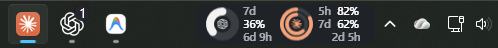
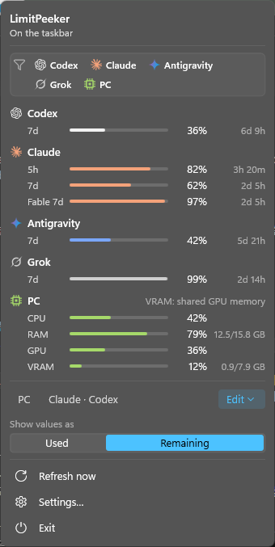
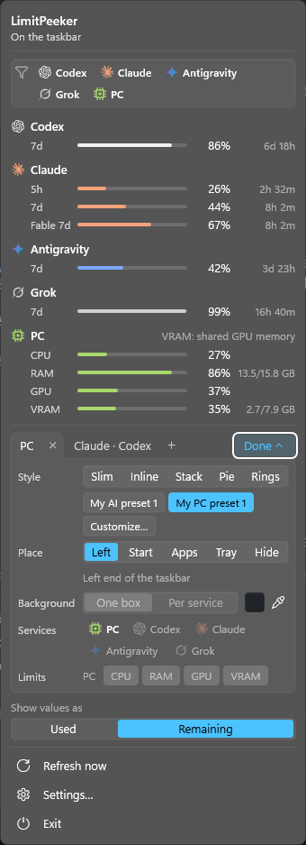
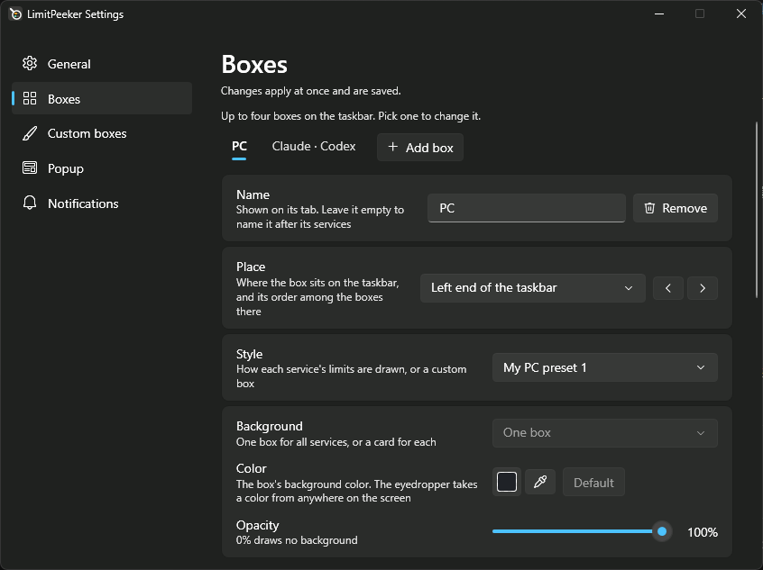
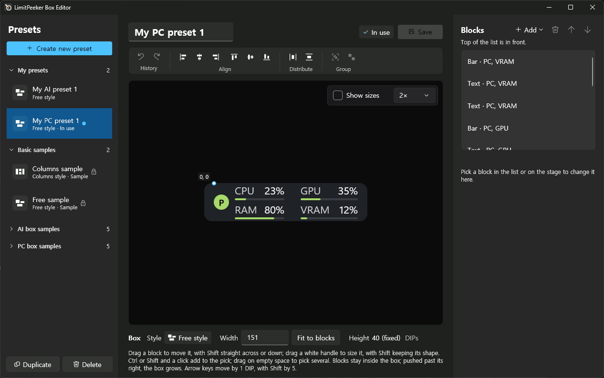
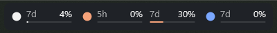
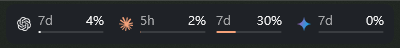

# LimitPeeker

A usage monitor for AI coding subscriptions, on the Windows 11 taskbar. LimitPeeker keeps the rate limits of Codex,
Claude Code, Antigravity (Gemini) and Grok in small boxes beside the tray, as numbers and gauges, so you see how much of
each 5-hour or weekly limit is used, or left, without opening anything.



Values turn orange at 20% left and red at 5%, and a Windows notification tells you when a limit is almost used up, used
up, or available again, and when a service cannot be read for 30 minutes. Click the tray icon or right-click a box for the popup, which lists every limit, when each
resets, and this PC's load, and lets you change a box in place.

| The popup | With a box's settings unfolded |
| --- | --- |
|  |  |

## How it differs from a tray icon

- **Boxes on the taskbar itself.** Up to four, each with its own services, look and place: the left end, before the Start
  button, after the last app, or beside the tray. Five looks come with it (a thin bar, a bar beside or under the text, a
  pie, rings), and a box editor lets you design your own from bars, rings, pies, text and icons.
- **Four services and this PC.** Codex (a ChatGPT subscription), Claude (Claude Code), Antigravity (Gemini models, through its CLI), Grok
  (the Grok CLI), and CPU, RAM, GPU and VRAM as the service `PC`.
- **It asks the tools, not their log files.** Every 5 minutes (Grok every 15), LimitPeeker starts the tools you
  already use, signed in, without a window, and asks them for their limits, the same way for the apps, the CLIs, the
  VS Code extensions and `npm` installs. A read takes a few seconds (about 8 for Antigravity), and only the services you show are read. No
  model is called, so no tokens are spent, and no sign-in data is read or stored.
- **Nothing phones home.** LimitPeeker itself goes on the network only when you press `Check for updates`. Turned on,
  `Tool updates` on the settings window's `General` page runs each tool's own update command every 15 minutes, which
  downloads from that tool's maker (it is off at first; [more](docs/services.md#updates-of-the-tools)).

> **Note.** To draw its boxes, a small DLL runs **inside Explorer** (XAML diagnostics). This is not a way of extending the
> taskbar that Windows supports, so a Windows update may stop it from working or affect Explorer. To use only the tray
> icon and the popup, start it with `--tray-only`. [How it attaches](docs/how-it-works.md).

## Requirements

- Windows 11 x64, with a horizontal taskbar at the bottom of the main display.
- At least one signed-in tool to read from: Codex (the app, the CLI or the VS Code extension), Claude Code (the CLI or the
  VS Code extension), the Antigravity CLI (`agy`) or the Grok CLI (`grok`). See [Services](docs/services.md).
- The .NET Desktop Runtime 10, for the settings window only.
- A normal user account. Started as administrator, it uses only the tray, without boxes.

## Install

1. Download the zip from the [Releases page on GitHub](../../releases/latest) and drag the `LimitPeeker` folder inside it to a
   place you will keep, such as `C:\Tools`. Keep the files together: `limitpeeker_xaml.dll` must stay next to
   `limitpeeker.exe`.
2. Install the .NET Desktop Runtime 10 (x64), from
   [dotnet.microsoft.com/download/dotnet/10.0](https://dotnet.microsoft.com/download/dotnet/10.0) or with:

   ```powershell
   winget install Microsoft.DotNet.DesktopRuntime.10
   ```

   Only the settings window needs it. Without it the boxes, the tray icon and the popup still work; `Settings…` says
   what is missing and offers to open the download page.
3. Run `limitpeeker.exe`. It is not code-signed, so Windows SmartScreen may show "Windows protected your PC" the first
   time; choose **More info**, then **Run anyway**.
4. To start it when you sign in, turn on `Start with Windows` on the settings window's `General` page
   ([more](docs/startup.md)).

## Use

- **Boxes.** Run `limitpeeker.exe` and it attaches to Explorer and draws its boxes on the taskbar. Drag a box to move it.
- **Popup.** Click the tray icon, or right-click a box, to see every limit and when it resets. `Edit` unfolds the chosen
  box's services, limits, look and place; `Hide` takes a box off the taskbar without losing its settings. The swatch on
  the `Background` line picks the box's background color, with an eyedropper for a color on the screen.
- **Settings window.** `Settings…` in the popup has the same choices as pages, with the language, starting at sign-in,
  notifications, the box editor and `Check for updates`. It is in English, Spanish, French, Japanese, Korean or
  Portuguese (Brazil).
- **Exit.** `Exit` in the popup closes LimitPeeker and puts the taskbar back as it was.

| The settings window | The box editor |
| --- | --- |
|  |  |

More in [Boxes, the popup and the settings window](docs/boxes-and-popup.md) and [Custom boxes](docs/custom-boxes.md).

## Logos

The services' logos are their companies' trademarks, so they are not included: as downloaded, each service shows as a
dot in its color. To see the logos, as in the pictures here, put your own `.svg` or `.png` files in the `icons` folder;
`Open icons folder` on the settings window's `Boxes` page opens it, and `icons\README.txt` says how.

| As downloaded | With your own logos in `icons` |
| --- | --- |
|  |  |

## Questions

- **Does it spend my tokens or count as usage?** No. It asks each tool for the limits it already knows, as the tool's
  own usage display does; no prompt is sent and no model is called.
- **Does it see my passwords or keys?** No. It never reads or stores sign-in data; the tools stay signed in as they are,
  and LimitPeeker only starts them and reads their answer ([how each is read](docs/services.md)).
- **Does it change my tools' settings?** One thing only: when Claude Code's usage request fails, it marks the hidden
  Claude Code's home folder as trusted in Claude Code's `.claude.json`, so that Claude Code does not stop to ask.
  LimitPeeker writes nothing else there, and `uninstall.exe` removes that folder's entries
  ([more](docs/services.md#claude)).
- **Is it safe to run inside Explorer?** The DLL only lays out the boxes and talks to LimitPeeker through shared memory.
  LimitPeeker never restarts Explorer by itself, and `Exit` puts the taskbar back. Still, this is not a supported way of
  extending the taskbar, and a Windows update may break it; `--tray-only` avoids it
  ([details](docs/how-it-works.md)).
- **The tray icon is hidden.** Windows 11 puts new tray icons in the hidden area. To keep it in view, turn LimitPeeker on
  under Settings > Personalization > Taskbar > Other system tray icons.
- **The tray says `Restart Explorer to show the box`.** This Explorer is in a state LimitPeeker cannot attach to, and
  it stays so until Explorer restarts. Press `Restart Explorer` in the popup. Once LimitPeeker has attached to an
  Explorer, restarting LimitPeeker in it does not need this again ([why](docs/how-it-works.md)).

## Uninstall

Run `uninstall.exe` in LimitPeeker's folder **before deleting the folder** (it runs `limitpeeker.exe --remove`). It asks
first, closes LimitPeeker and removes what it left on this PC: the start with Windows, its data in
`%LOCALAPPDATA%\LimitPeeker`, and the entries it may have added to Claude Code's `.claude.json`. Then delete the folder;
if Explorer still holds the DLL, restart Windows Explorer in Task Manager or sign out first.
[Details](docs/uninstall.md).

## Updates

`Check for updates` on the settings window's `General` page asks GitHub for the newest release, only when you press it,
and if there is a newer one, says so with a button that opens the releases page. Nothing is downloaded or installed for
you. To hear of new releases, you can also watch this repository on GitHub (Watch > Custom > Releases).

To update, close LimitPeeker, open the new zip, drag its `LimitPeeker` folder to the same place as before and choose to
replace the files, then start it again. The logos you put in `icons` stay. Explorer keeps `limitpeeker_xaml.dll` until it
restarts, so if that file is in use, restart Windows Explorer in Task Manager first.

## Known limits

- Only a horizontal taskbar at the bottom of the main display is supported, and the boxes show only there.
- It was checked on one PC, on Windows 11 builds 26200 and 26300, at scales of 100% to 175%.
- The services' own ways of telling their limits are not public interfaces, so a service's update may stop its values
  until LimitPeeker is updated.
- Screen readers cannot read the popup; the same options are in the settings window.

## Documentation

- [Services and how they are read](docs/services.md)
- [Boxes, the popup and the settings window](docs/boxes-and-popup.md)
- [Custom boxes](docs/custom-boxes.md)
- [Start with Windows](docs/startup.md)
- [Uninstall](docs/uninstall.md)
- [Command-line options and the log](docs/command-line.md)
- [How it attaches to the taskbar](docs/how-it-works.md)
- [Building](docs/building.md)
- [Translating the settings window](docs/translating.md)

## License

MIT. See [LICENSE](LICENSE). The pattern for attaching to the taskbar's XAML was adapted from TaskbarWidgets (MIT); see
[THIRD_PARTY_NOTICES.md](THIRD_PARTY_NOTICES.md).

LimitPeeker is not affiliated with or endorsed by OpenAI, Anthropic, Google or xAI. Their services are named only to say
which ones LimitPeeker reads, and their names and logos belong to them.
